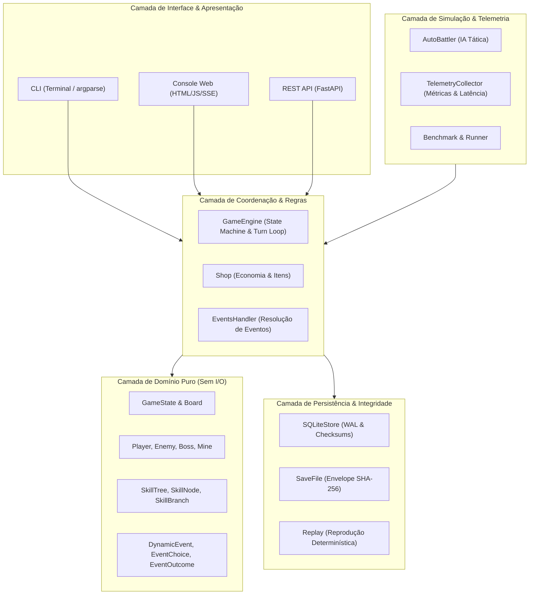
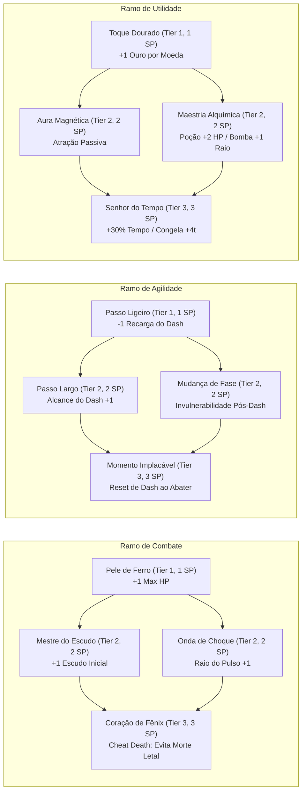
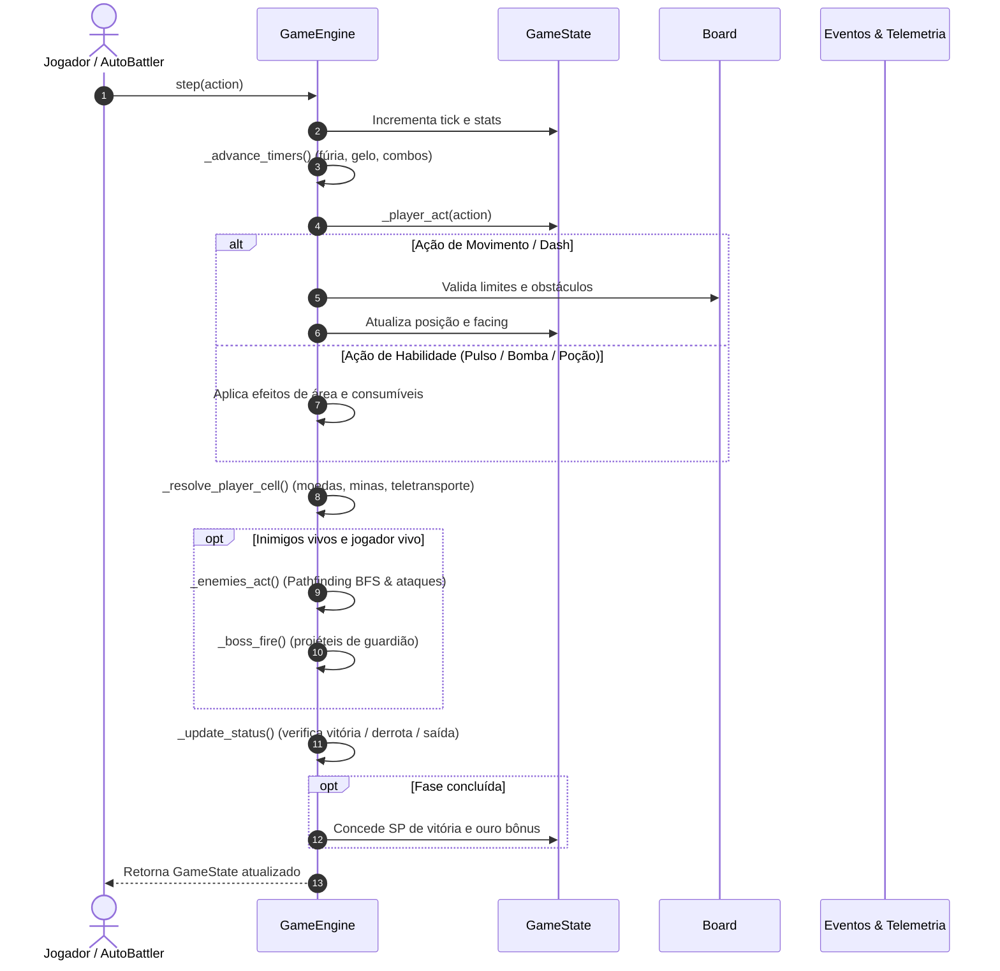
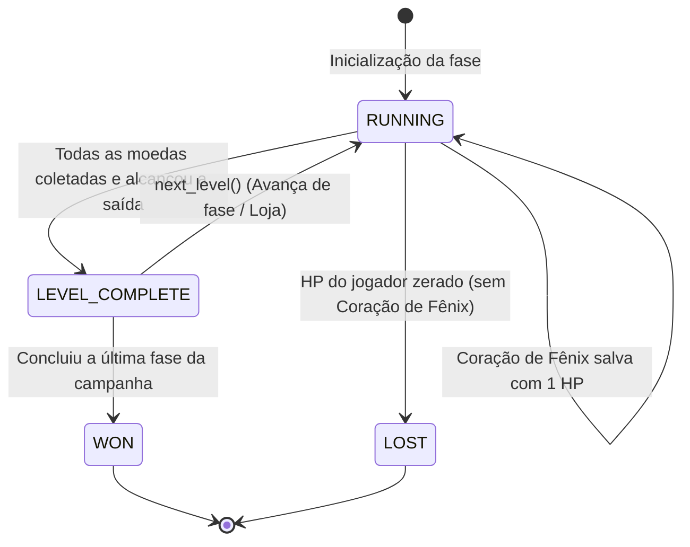
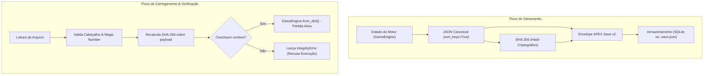

# Arquitetura do APEX NEXUS

Este documento detalha o design de software, organização em camadas, fluxo de execução por turnos e os subsistemas adicionados na versão 21.3.0.

---

## 1. Visão Geral das Camadas (Clean Architecture)

O projeto adota uma separação estrita de responsabilidades inspirada em Arquitetura Limpa e Ports & Adapters, garantindo que o núcleo de domínio e regras de negócio permaneçam completamente desacoplados de bibliotecas de terminal, rede ou banco de dados:

---

## 2. Árvore de Habilidades (Skill Tree)

O subsistema de habilidades (`domain/skills.py`) é estruturado em três ramificações com nós encadeados por pré-requisitos e pontos de perícia (SP):

---

## 3. Ciclo de Turno do Motor (`GameEngine.step`)

Cada ação do jogador executa uma transição de estado estritamente determinística:

---

## 4. Máquina de Estados da Partida (`GameStatus`)

---

## 5. Integridade Criptográfica de Saves (SHA-256)

Para proteger partidas salvas contra corrupção e modificações indevidas, foi introduzido o envelope criptográfico nos formatos `.sqlite3` e `.save.json`:

---

## 6. Auto-Battler e Telemetria

O módulo `simulation/auto_battler.py` orquestra jogadas automáticas através de heurísticas configuradas em 4 perfis táticos:

1. **Balanced**: Equilibra coleta de recursos, evasão e combate metódico.
2. **Aggressive**: Prioriza abate de inimigos com Fúria, Pulsos e bombas ofensivas.
3. **Survivor**: Prioriza conservação máxima de HP, escudos e rotas de fuga seguras.
4. **Collector**: Foco total em maximização de moedas, bônus dourados e telemetria espacial.

O `TelemetryCollector` (`simulation/telemetry.py`) amostra o desempenho do motor via `time.perf_counter()` em cada turno, registrando latência média por passo, picos de processamento, células mais visitadas e turnos em risco crítico.
